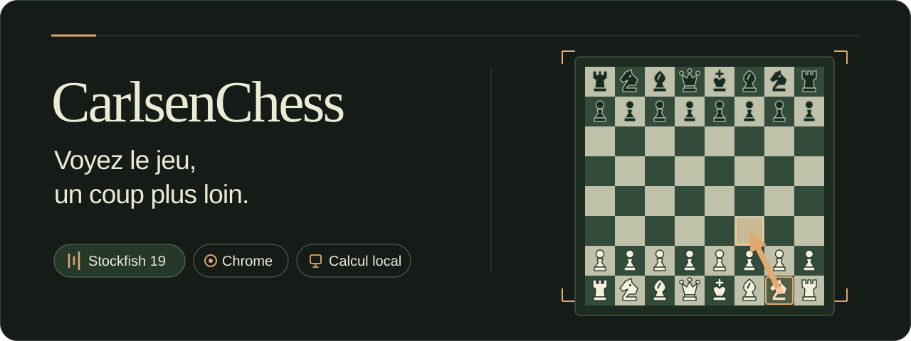
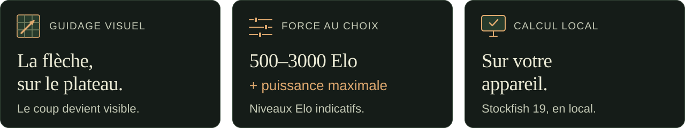
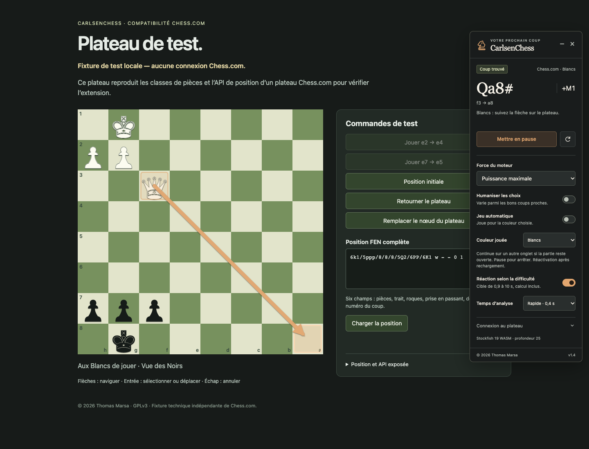
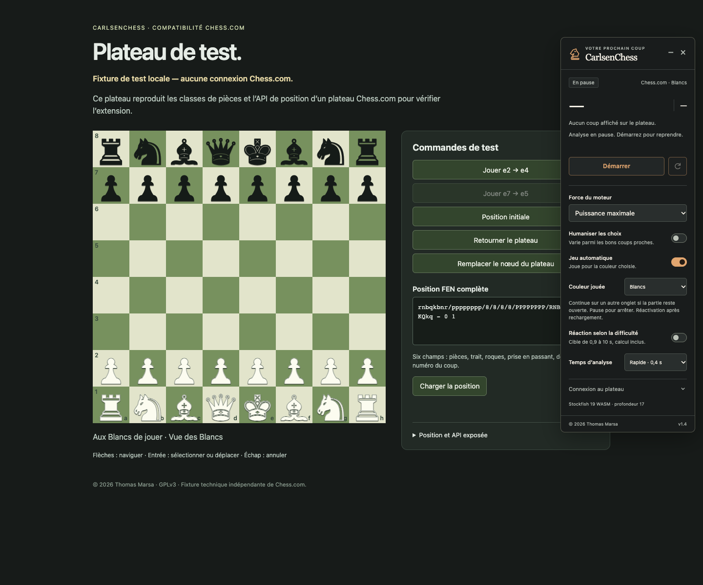

<p align="center">
  
</p>

<p align="center">
  <strong>Votre prochain coup, directement sur le plateau.</strong><br>
  Un panneau compact. Une flèche claire. Toute l’analyse sur votre appareil.
</p>

<p align="center">
  <a href="https://github.com/ThomasMrs/CarlsenChess/releases/tag/v1.4.0"></a>
  <a href="https://github.com/ThomasMrs/CarlsenChess/actions/workflows/ci.yml"></a>
  <a href="LICENSE"></a>
  
</p>

<p align="center">
  <a href="https://github.com/ThomasMrs/CarlsenChess/releases/download/v1.4.0/CarlsenChess-v1.4.0.zip"></a>
  <br>
  <sub>Gratuit · Open source · ZIP d’environ 76 Mo · Installation manuelle</sub>
</p>

<p align="center">
  <a href="#installation">Installer</a> ·
  <a href="#apercu">Aperçu</a> ·
  <a href="#fonctions">Fonctions</a> ·
  <a href="docs/GUIDE.md">Guide complet</a> ·
  <a href="https://github.com/ThomasMrs/CarlsenChess/releases/latest">Dernière version</a>
</p>



<a id="apercu"></a>

## Le coup devient visible

CarlsenChess relie **Stockfish 19** à votre plateau d’échecs dans Chrome. Le panneau affiche le coup et son évaluation ; la flèche montre précisément la pièce à déplacer et sa case d’arrivée.

<a href=".github/assets/preview.png"></a>

<p align="center"><sub>Interface réelle de l’extension, sur la démo locale incluse dans le projet.</sub></p>

<table>
  <tr>
    <td width="50%" valign="top">
      <a href=".github/assets/chesscom-fixture.png"></a>
      <strong>Le plateau suivi automatiquement</strong><br>
      <sub>L’adaptateur relit la position complète après chaque coup. Capture sur plateau de test local.</sub>
    </td>
    <td width="50%" valign="top">
      <a href=".github/assets/autoplay-fixture.png"></a>
      <strong>Les réglages restent à portée de main</strong><br>
      <sub>Camp choisi, jeu automatique optionnel, réaction selon la difficulté et pause. Capture sur plateau de test local.</sub>
    </td>
  </tr>
</table>

<a id="fonctions"></a>

## À votre façon de jouer

| Catégorie | Ce que propose CarlsenChess |
| :--- | :--- |
| **Sur le plateau** | Flèche de départ et d’arrivée, notation du coup et évaluation pour les Blancs. Orientation automatique ou manuelle. |
| **Force au choix** | Paliers de **500, 1000, 1500, 2000, 2500 et 3000 Elo indicatifs**, ou puissance maximale. Les profils 500/1000 sont simulés et ne sont pas des classements mesurés. |
| **Variété des coups** | **Humaniser les choix** ajoute de la variété parmi les candidats admissibles. |
| **Jeu automatique** | Option pour l’adaptateur Chess.com : choix Blancs/Noirs, attente du tour adverse et poursuite sur un autre onglet si la partie reste ouverte. |
| **Temps de réaction** | Cible estimée de **0,9 à 10 secondes** selon la position, calcul inclus. Réglage indépendant de l’humanisation et arrêt à la pause. |
| **Moteur local** | Stockfish.js **19.0.1 complet** en WebAssembly. Aucune clé API ni service distant pour le calcul. Réglages enregistrés localement. |

<a id="installation"></a>

## Installer en quatre étapes

**Google Chrome 116 ou ultérieur.** Le ZIP contient déjà le moteur et les fichiers de l’extension.

1. **[Télécharger CarlsenChess v1.4.0](https://github.com/ThomasMrs/CarlsenChess/releases/download/v1.4.0/CarlsenChess-v1.4.0.zip)**, puis décompresser le ZIP.
2. Ouvrir `chrome://extensions` et activer le **Mode développeur**.
3. Cliquer sur **Charger l’extension non empaquetée**, puis sélectionner le dossier **CarlsenChess** qui contient `manifest.json`.
4. Épingler l’extension, ouvrir le plateau, cliquer sur son icône, puis sur **Démarrer**.

Pour le jeu automatique, choisir **Blancs** ou **Noirs**, activer **Jeu automatique** et laisser le mode FEN manuel désactivé. **Mettre en pause** arrête les actions en attente.

<details>
<summary><strong>Mettre à jour une installation existante</strong></summary>

Remplacer les fichiers du dossier déjà chargé par ceux du nouveau ZIP, cliquer sur **Recharger** dans `chrome://extensions`, puis recharger la page du jeu. Réactiver le jeu automatique si souhaité ; son activation n’est pas conservée après rechargement ou fermeture du panneau.

</details>

## Pour quels plateaux ?

| Plateau | Connexion |
| :--- | :--- |
| **Chess.com** | Adaptateur dédié : FEN complète, comparaison avec les pièces et suivi de l’orientation. |
| **Démo locale incluse** | Plateau jouable pour découvrir l’interface et essayer les suggestions. |
| **Votre propre jeu** | Attribut FEN complet, sélecteur CSS ou saisie manuelle. Voir le [guide d’intégration](docs/GUIDE.md#relier-un-autre-jeu-en-ligne). |

Les captures et essais navigateur utilisent des plateaux locaux reproduisant le contrat de Chess.com. **Un parcours complet avec clics sur le site réel reste à vérifier.** Les API internes du site peuvent évoluer. Les valeurs Elo et les délais sont des estimations ; aucune indétectabilité n’est garantie. [Détails de fonctionnement et limites](docs/GUIDE.md#utiliser-chesscom).

## Questions fréquentes

<details>
<summary><strong>Pourquoi le ZIP fait-il environ 76 Mo ?</strong></summary>

Le moteur Stockfish complet et son réseau neuronal sont embarqués dans l’extension. Une fois installée, l’analyse ne nécessite aucun calcul distant.

</details>

<details>
<summary><strong>Le jeu automatique fonctionne-t-il en arrière-plan ?</strong></summary>

Oui, le changement d’onglet conserve son activation si la partie reste ouverte. Chrome peut ralentir ou suspendre un onglet : la cadence n’est donc pas garantie. Fermer ou recharger la page de la partie demande une réactivation. Si une entrée n’est pas confirmée, le panneau indique une suspension pour cette position et ne répète pas les clics ; jouer le coup manuellement permet de reprendre.

</details>

<details>
<summary><strong>Quelles permissions sont demandées ?</strong></summary>

`activeTab` accorde l’accès à l’onglet après un clic sur l’icône. `scripting` insère l’interface et les adaptateurs, `storage` conserve les réglages et `offscreen` héberge le moteur. Aucun accès permanent à l’ensemble des sites n’est demandé. [Voir les permissions en détail](docs/GUIDE.md#fonctionnement-et-permissions).

</details>

## Explorer le projet

| Ressource | Pour aller plus loin |
| :--- | :--- |
| [Guide complet](docs/GUIDE.md) | Réglages, fonctionnement, build, tests et intégration d’un autre plateau. |
| [Versions et téléchargements](https://github.com/ThomasMrs/CarlsenChess/releases) | ZIP installable, sources complètes et empreintes SHA-256. |
| [Démo locale](demo/) | Plateau d’essai et fixture de l’adaptateur. |
| [Signaler un problème](https://github.com/ThomasMrs/CarlsenChess/issues/new) | Décrire le comportement, la version et les étapes pour le reproduire. |
| [Licence](LICENSE) · [Composants tiers](THIRD_PARTY_NOTICES.md) | GPL-3.0-only, crédits et sources correspondantes de Stockfish. |

Pour travailler sur le code :

```sh
npm ci
npm run build
npm test
```

---

<p align="center">
  <strong>CarlsenChess — © 2026 Thomas Marsa</strong><br>
  <sub>Projet indépendant, non affilié à Chess.com. Stockfish et chess.js conservent leurs auteurs et licences.</sub><br>
  <a href="https://github.com/ThomasMrs/CarlsenChess/releases/latest">Télécharger la dernière version</a> · <a href="docs/GUIDE.md">Lire le guide</a>
</p>
