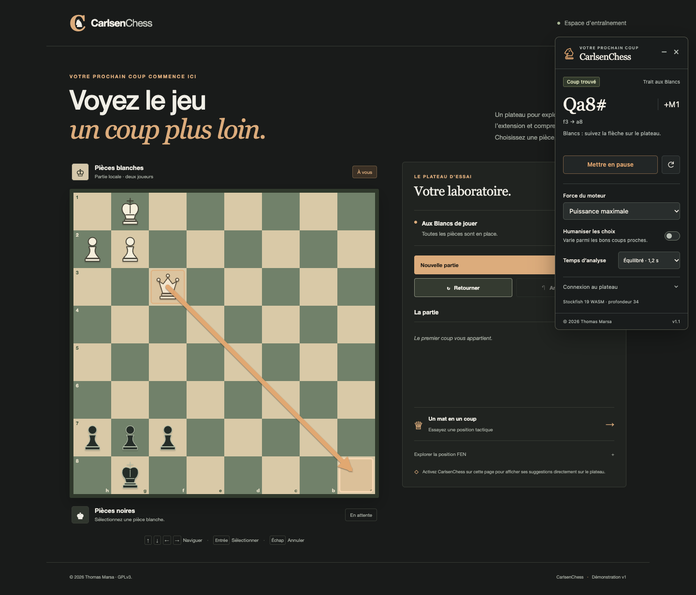

# CarlsenChess

Extension Google Chrome Manifest V3 créée par **Thomas Marsa**, avec un panneau compact à droite et des indications directement sur le plateau. Stockfish 19 analyse les positions localement ; une flèche indique la pièce à déplacer et sa case d’arrivée. Sur Chess.com, l’option **Jeu automatique** peut jouer le coup proposé pour la couleur choisie.

Le mode **Puissance maximale** utilise la force disponible du moteur. Le réglage **Elo indicatif** propose les paliers **500, 1000, 1500, 2000, 2500 et 3000**. Ces valeurs ne sont pas des classements humains mesurés ou garantis. Le mode **Humaniser** ajoute de la variété aux propositions ; le réglage de force reste actif lorsqu’il est désactivé.



## Installer la version 1.4.0

Prérequis : Google Chrome 116 ou version ultérieure. Node.js 20.19 ou version ultérieure est nécessaire uniquement pour reconstruire le projet depuis ses sources.

```sh
git clone https://github.com/ThomasMrs/CarlsenChess.git
cd CarlsenChess
npm ci
npm run build
```

1. Ouvrir `chrome://extensions` et activer le **Mode développeur**.
2. Cliquer sur **Charger l’extension non empaquetée**.
3. Sélectionner le dossier `dist/CarlsenChess`.
4. Épingler CarlsenChess dans la barre d’outils de Chrome.
5. Ouvrir le jeu, puis cliquer sur l’icône CarlsenChess pour afficher le panneau.

Le build produit aussi `dist/CarlsenChess-v1.4.0.zip` et l’archive complète de sources `dist/CarlsenChess-v1.4.0-source.zip`. Si vous avez téléchargé l’archive de l’extension déjà construite, la décompresser puis charger le dossier qui contient `manifest.json`.

Après une modification du code, relancer `npm run build`, recharger l’extension dans `chrome://extensions`, puis recharger la page du jeu et cliquer sur l’icône.

## Utiliser le panneau

Choisir la force souhaitée et l’option d’humanisation, puis cliquer sur **Démarrer**. Dès qu’une position complète est disponible, le panneau affiche une suggestion pour le camp au trait et la flèche apparaît sur le plateau. Dans **Connexion au plateau**, l’orientation peut être ajustée pour correspondre au plateau retourné. Les réglages sont enregistrés localement, à l’exception de l’activation du jeu automatique.

La position est réanalysée lorsque le jeu met à jour sa FEN. Une FEN saisie manuellement reste la position saisie : mettre en pause, la remplacer après chaque coup puis redémarrer pour analyser la nouvelle position.

## Utiliser Chess.com

1. Ouvrir [Chess.com](https://www.chess.com) dans Google Chrome, puis afficher un plateau de partie ou d’analyse.
2. Cliquer sur l’icône CarlsenChess dans la barre d’outils.
3. Choisir la force et l’option **Humaniser**, puis cliquer sur **Démarrer**. Laisser le mode FEN manuel désactivé pour suivre le plateau automatiquement.

### Jouer automatiquement

Choisir **Blancs** ou **Noirs** dans **Couleur jouée**, activer **Jeu automatique**, puis cliquer sur **Démarrer** si l’analyse est en pause. L’extension attend le tour de cette couleur, calcule une proposition, puis tente de la jouer sur le plateau. Elle reprend après le coup adverse. Les promotions utilisent la pièce exacte choisie par le moteur, y compris une sous-promotion.

Le jeu automatique continue lorsqu’un autre onglet est actif, tant que la partie reste ouverte dans son onglet. Un changement de visibilité ne décoche plus l’option et ne remet pas à zéro l’attente de réaction. **Mettre en pause** annule les actions en attente. Fermer le panneau, recharger ou quitter la page de la partie désactive toujours le jeu automatique ; il faut le réactiver après un rechargement. Le mode FEN manuel ne permet pas le jeu automatique.

Chrome peut ralentir les minuteurs d’un onglet en arrière-plan, le suspendre ou le décharger. Le délai réel peut donc dépasser la cible ; l’extension ne garantit pas le fonctionnement d’une page suspendue, fermée ou d’un ordinateur en veille. Elle ne modifie pas les réglages d’économie de mémoire du navigateur.

**Réaction selon la difficulté**, activé par défaut, adapte le délai à une estimation de la complexité de la position. Un coup légal unique reçoit une cible courte ; plusieurs options proches ou des complications tactiques peuvent allonger l’attente. La cible varie de **0,9 à 10 secondes** depuis la détection de la position. Le temps déjà passé à calculer est déduit, avec un minimum de 400 ms d’attente après le calcul. Si le calcul dépasse la cible, le coup attend donc encore 400 ms. Le panneau indique l’attente restante et sa raison. Le réglage est enregistré indépendamment de **Humaniser les choix** ; le désactiver rétablit l’attente fixe de 400 ms après le calcul.

Cette estimation utilise les coups légaux et les évaluations comparables de Stockfish ; elle ne mesure pas une difficulté humaine. Sans évaluations suffisantes, la cible neutre est de 3,2 secondes. Elle ne lit pas les pendules de la partie. La pause et les changements de position ou de réglages annulent aussi une attente longue.

Les clics synthétiques sont observables par le site : **aucune indétectabilité n’est garantie**. Aucun mécanisme de dissimulation ou de contournement de la confiance des entrées n’est fourni. Si Chess.com refuse un coup ou si le résultat ne peut pas être confirmé après l’envoi d’une entrée, le panneau affiche **Jeu automatique suspendu pour cette position**, conserve l’option cochée et ne renvoie aucun clic sur cette même position. Jouer le coup manuellement permet de reprendre à la position suivante. Avant toute entrée, une géométrie temporairement indisponible peut être revérifiée deux fois au maximum, avec une nouvelle lecture de la position et une seconde d’attente entre les essais.

[Capture du panneau avec le jeu automatique, sur plateau de test local](../.github/assets/autoplay-fixture.png).

### Lecture du plateau

Le panneau lit la FEN complète exposée par le jeu via `wc-chess-board.game.getFEN()`. Le script de fond effectue cette lecture dans le contexte JavaScript **MAIN** de la page, car le script d’interface de l’extension s’exécute dans un contexte isolé. Le placement est comparé aux pièces visibles avant de transmettre la FEN à Stockfish. Le trait, les droits de roque, la prise en passant et les compteurs proviennent de la FEN du jeu.

La lecture reprend environ toutes les **350 ms pendant l’analyse**, sous réserve des ralentissements imposés par Chrome, et s’arrête à la pause ou à la fermeture du panneau. Une lecture fraîche est aussi demandée à la fin du calcul et avant chaque action, y compris après un réveil de minuteur tardif. Les coups suivants et l’orientation du plateau sont suivis automatiquement. Le placement exact des pièces est toujours comparé à la FEN ; en arrière-plan, un indicateur d’animation visuelle resté actif ne bloque plus à lui seul cette lecture. La géométrie de la pièce source et les cases sont revérifiées avant le clic. Si plusieurs plateaux sont présents, renseigner le sélecteur exact dans **Connexion au plateau**, par exemple `#board-analysis-board` pour le plateau d’analyse observé. L’orientation peut aussi être réglée manuellement.

Si le plateau ou sa FEN ne sont pas encore disponibles, le panneau affiche un message d’attente. Après un rechargement de l’extension, recharger aussi la page Chess.com et cliquer de nouveau sur l’icône. Le mode FEN manuel reste disponible dans **Connexion au plateau**.

L’API `game.getFEN()` et les classes des pièces sont des détails internes de Chess.com. Une modification du site peut nécessiter une mise à jour de l’adaptateur. Le DOM de la page réelle `/analysis` a été inspecté dans Chrome : `wc-chess-board#board-analysis-board`, les éléments `.piece` avec classes `square-NN` et le sélecteur de promotion `.promotion-window--visible .promotion-piece.<couleur><pièce>` y ont été observés. Les échanges avec l’API, les clics et le moteur sont vérifiés sur des fixtures locales reproduisant ces contrats ; aucune partie contre un adversaire en ligne n’a été exercée pour cette version.

[Capture du test Chess.com sur fixture locale](../.github/assets/chesscom-fixture.png).

## Relier un autre jeu en ligne

La détection générique prend en charge les jeux qui exposent une **FEN complète de six champs** dans le document principal de la page. La détection d’un dessin de plateau ne suffit pas à déterminer les droits de roque, la prise en passant ou le camp au trait.

La meilleure intégration consiste à ajouter ces attributs au conteneur exact du plateau :

```html
<div
  id="board"
  data-carlsenchess-board
  data-carlsenchess-orientation="white"
  data-carlsenchess-fen="rnbqkbnr/pppppppp/8/8/8/8/PPPPPPPP/RNBQKBNR w KQkq - 0 1"
></div>
```

Après **chaque coup**, mettre à jour la FEN depuis l’état réel du jeu. Avec chess.js, par exemple :

```js
const boardElement = document.querySelector('[data-carlsenchess-board]');

function syncCarlsenChess(game, orientation = 'white') {
  boardElement.dataset.carlsenchessFen = game.fen();
  boardElement.dataset.carlsenchessOrientation = orientation;
}
```

Utiliser `black` pour l’orientation lorsque les pièces noires sont en bas. La FEN doit inclure le placement, le camp au trait, les droits de roque, la case de prise en passant, le compteur de demi-coups et le numéro du coup. Ne pas reconstruire ces informations à partir des seules pièces visibles.

Le détecteur cherche le plus grand plateau visible parmi les sélecteurs suivants :

```css
[data-carlsenchess-board], wc-chess-board, cg-board, chess-board, .chess-board, #board, .board
```

Il lit `data-carlsenchess-fen`, `data-fen` ou `data-chess-fen` sur le plateau ou un conteneur propre à ce plateau. Le panneau permet de préciser un sélecteur CSS du plateau, un sélecteur de source FEN ou une FEN manuelle. Un champ de texte ciblé par le sélecteur FEN peut aussi fournir la FEN complète. Si plusieurs plateaux sont présents, renseigner leur sélecteur exact.

Les plateaux enfermés dans une iframe ou une racine Shadow DOM ne font pas partie de la détection générique. Ils nécessitent un adaptateur adapté au jeu.

Le jeu automatique est réservé à l’adaptateur Chess.com ; les autres jeux conservent les suggestions et les flèches.

## Essayer et vérifier

```sh
npm test
npm run demo
```

Ouvrir ensuite [la démonstration locale](http://127.0.0.1:8787/demo/), puis cliquer sur l’icône de l’extension. La démo expose une FEN complète et permet de vérifier le positionnement des indications. Cliquer sur **Démarrer** dans le panneau pour lancer le moteur.

```sh
npm run test:e2e
npm run test:chesscom
npm run test:autoplay
```

La vérification de navigateur utilise Playwright et Chromium en mode sans interface. Selon l’environnement, installer d’abord le navigateur avec `npx playwright install chromium`.

`test:e2e` charge une copie provisoire de l’extension avec un accès limité à `http://127.0.0.1/*`, car Playwright ne peut pas cliquer sur le bouton de la barre d’outils pour accorder `activeTab` dans ce mode. L’injection, l’interface, les échanges entre composants et le véritable moteur WebAssembly utilisent les fichiers de production. Ce test couvre les suggestions, le changement de position et d’orientation, les réglages, l’arrêt de l’analyse et la saisie FEN.

`test:chesscom` utilise une fixture locale dont les requêtes sont interceptées sous l’origine `https://www.chess.com`. Ce test ne charge pas le jeu réel : il reproduit le plateau, les classes des pièces et `game.getFEN()`. Il vérifie la séparation **MAIN/ISOLATED**, la lecture automatique de la FEN complète, les changements de trait et d’orientation, le remplacement du plateau, les résultats périmés, les erreurs d’API et l’arrêt des lectures à la pause, avec le véritable moteur Stockfish. Seule sa copie provisoire du manifeste reçoit un accès à l’origine de la fixture.

`test:autoplay` utilise également une fixture locale interceptée sous l’origine Chess.com, avec le véritable moteur. Il couvre les paliers 500/1000, l’activation explicite, le camp choisi, l’attente du coup adverse, le changement de camp pendant le calcul, la réaction adaptative, la pause, la poursuite avec documents MAIN et ISOLATED masqués, l’erreur suspendue sans décochage et la désactivation après rechargement. Les tests Node.js vérifient aussi les réveils tardifs, la lecture fraîche, les promotions cachées, les demandes périmées, l’absence de clic répété après refus et une nouvelle partie sur le même nœud après un coup confirmé. Les scénarios de visibilité simulée ne reproduisent pas toutes les politiques de suspension ou de déchargement de Chrome.

Ces tests laissent les permissions du manifeste distribué inchangées. L’octroi manuel de `activeTab` et un parcours complet sur le jeu réel restent à vérifier dans Chrome avec le bouton de l’extension. Les fixtures ne valident aucune indétectabilité.

La CI GitHub exécute les tests Node.js sur Node 22, y compris les vérifications du manifeste et du moteur Stockfish réel. Les tests de navigateur se lancent localement.

## Fonctionnement et permissions

Le clic sur l’icône accorde l’accès à l’onglet courant avec `activeTab`. `scripting` insère l’interface et permet la lecture et les clics Chess.com dans le contexte MAIN du document source, `storage` conserve les réglages et `offscreen` héberge le moteur dans un document de l’extension. Le jeu automatique n’ajoute aucune permission au manifeste. Le moteur WebAssembly fonctionne dans un Worker local de ce document, indépendamment de la politique CSP du jeu. Aucun accès permanent à l’ensemble des sites n’est demandé.

Stockfish.js **19.0.1**, variante complète à un seul thread, est embarqué dans l’extension. Une fois l’extension construite, l’analyse ne nécessite aucun service distant ni clé API. La force maximale et le temps de calcul réel dépendent de la machine et du budget d’analyse choisi.

Les cibles **1500 à 3000** utilisent `UCI_LimitStrength` et `UCI_Elo`, dans la plage native annoncée par Stockfish. Les profils **500 et 1000** sont approximatifs : niveaux `Skill Level` 0 et 4, recherche plafonnée aux profondeurs 3 et 6 et à 200 et 350 ms, variation parmi les candidats et probabilité bornée de choisir un autre coup légal. Cette réduction fonctionne indépendamment de l’option **Humaniser**. Sur ces deux profils, activer cette option augmente le poids des alternatives déjà admissibles dans le tirage pondéré, sans élargir leur sélection ni modifier la probabilité d’erreur. Ces profils ne constituent pas une calibration Elo. Le mode maximal rétablit le niveau complet du moteur. Les anciennes valeurs enregistrées sont arrondies au palier de 500 le plus proche.

Avant chaque action automatique, le coup légal est lié au plateau connecté, à sa FEN fraîche, à la couleur sélectionnée et à une autorisation limitée à cette demande. L’attente de réaction, d’au moins 400 ms après le calcul, laisse les changements de position ou la pause annuler l’action en attente. L’adaptateur envoie des événements DOM de pointeur et de souris, puis observe le résultat pendant une fenêtre nominale de 5 secondes. Il confirme le coup dès que l’API du jeu expose exactement le placement et le trait attendus, sans dépendre du dernier rendu visuel ; un réveil tardif relit toujours le résultat avant de conclure à l’expiration. La révocation du jeton est observée pour interrompre cette attente. Il ne modifie pas directement l’état interne du jeu et ne réessaie pas une action après qu’une entrée a été envoyée sans confirmation.

## Organisation du code

| Dossier ou fichier | Rôle |
| --- | --- |
| `extension/background.js` | Activation depuis la barre d’outils, relais des analyses, lectures et actions MAIN limitées au document Chess.com source. |
| `extension/content/` | Panneau, lecture de la FEN et indications sur le plateau. |
| `extension/content/chesscom-bridge.js` | Lecture du contrat Chess.com dans MAIN et comparaison avec le placement des pièces visibles. |
| `extension/content/chesscom-client.js` | Lectures périodiques, cache lié au plateau et rejet des réponses périmées. |
| `extension/content/autoplay.js` | Planification d’un coup pour la couleur choisie, autorisation temporaire et annulation des actions périmées. |
| `extension/content/reaction-time.js` | Estimation bornée du délai selon les coups légaux et des évaluations à profondeur commune. |
| `extension/content/chesscom-play.js` | Clics DOM Chess.com, choix exact de promotion et confirmation du résultat. |
| `extension/offscreen.html` et `extension/offscreen.js` | Document persistant du moteur et file d’analyses. |
| `extension/core/` | Protocole UCI, validation et sélection des suggestions. |
| `extension/engine/` et `extension/vendor/` | Stockfish local et règles chess.js. |
| `demo/` | Plateau d’essai jouable avec une FEN à jour. |
| `vendor-source/` | Sources exactes du moteur, réseau NNUE et instructions de compilation. |
| `scripts/` | Préparation, icônes, serveur de démo et archives de distribution. |
| `tests/` | Tests Node.js et vérifications de navigateur, dont la fixture locale Chess.com. |

## Crédit et licence

**CarlsenChess — © 2026 Thomas Marsa.** Le code du projet est distribué sous [GPL-3.0-only](../LICENSE).

Stockfish, Stockfish.js et chess.js conservent leurs auteurs, leurs droits d’auteur et leurs licences. Le crédit du projet ne transfère pas les droits sur ces composants. Voir [THIRD_PARTY_NOTICES.md](../THIRD_PARTY_NOTICES.md) pour les versions, licences et sources correspondantes.
